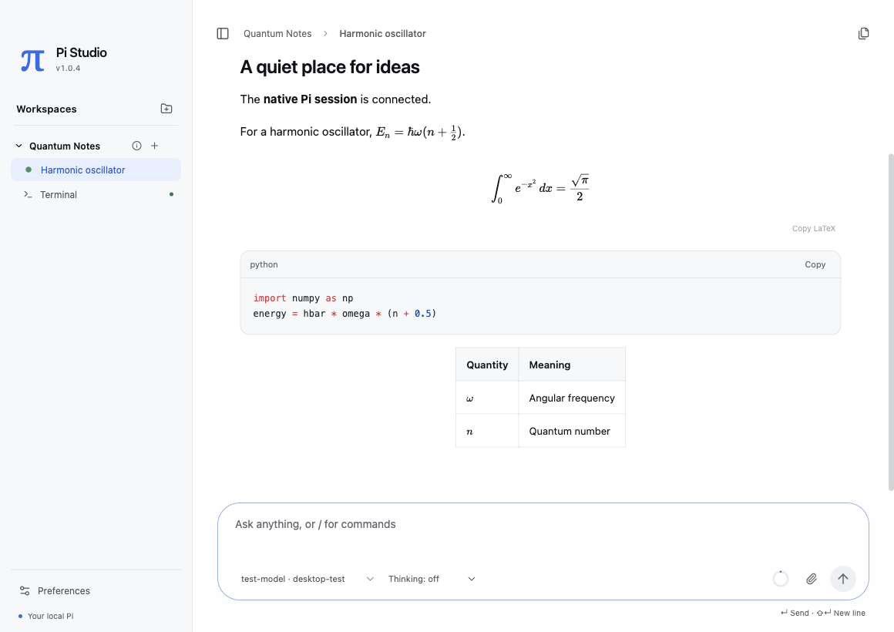
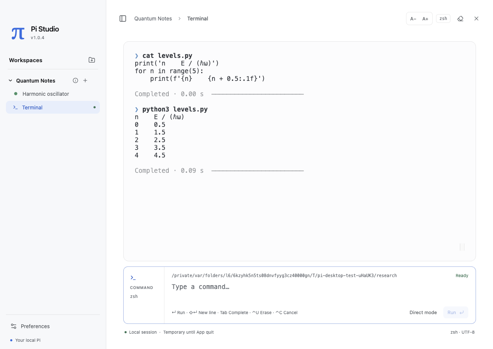

# Pi Studio

English · [简体中文](README.zh-CN.md)

Pi Studio is a desktop app that brings [Pi](https://pi.dev/) and a terminal into the same workspace.

> When I run a few Pi sessions in the terminal, I end up switching back and forth between tabs. Equations and tables can be hard to read there, too. The community has built plenty of desktop and web clients, but when I want to run a command myself, I still end up opening a separate terminal.
>
> That’s why I built Pi Studio.



Switch to the terminal in the same workspace to check the first five energy levels:



## Install on Apple Silicon

1. Install the Node.js version of Pi. As shown on [pi.dev](https://pi.dev/), you can run this in your terminal:

   ```bash
   curl -fsSL https://pi.dev/install.sh | sh
   ```

   Then run `pi`, select a model, sign in, and try sending a message. Studio uses your local Pi installation; it doesn’t install or upgrade Pi for you. For plugins, browse **Packages** on the Pi website and follow the installation instructions for the one you want.

2. Under **Releases → Assets**, download [`Pi-Studio-1.2.5-mac-arm64.dmg`](https://github.com/ymd-physics/pi-studio/releases/download/v1.2.5/Pi-Studio-1.2.5-mac-arm64.dmg). The `Source code` downloads are source archives, not installers.

3. Before installing, run this command in the folder containing the DMG. Compare the SHA-256 checksum with the one on the [1.2.5 release page](https://github.com/ymd-physics/pi-studio/releases/tag/v1.2.5). If they differ, delete the DMG and download it again from that page. Don’t install the mismatched copy.

   ```sh
   shasum -a 256 Pi-Studio-1.2.5-mac-arm64.dmg
   ```

4. Open the DMG, drag **Pi Studio.app** into **Applications**, eject the disk image, then launch Studio from Applications.

**Trouble opening Studio for the first time?** Pi Studio isn’t signed with an Apple Developer ID or notarized by Apple. If macOS says the app “can’t be opened” or “is damaged,” the download isn’t necessarily corrupt. Check the SHA-256 checksum above. If it matches but the app still won’t open, give your agent or AI assistant your macOS version and the full warning so it can help you troubleshoot. You don’t need to turn off system security protections.

From 1.0.4 onward, open **Preferences → About → Check for Updates** to read the release notes and download a newer DMG. Studio never installs updates automatically.

## Quick start

Studio starts in English. To switch to Simplified Chinese, open **Preferences → Appearance → Language** and choose **简体中文**. No restart is needed. This changes only the Studio interface, not the language of your conversations.

1. Click the **Add workspace** folder icon next to **Workspaces** in the sidebar. Choose an existing project folder or create one in the picker. If you’re comfortable giving Pi access to that folder, click **Trust workspace**.
2. Choose **+ → New conversation** beside the workspace. Try “Read the README and tell me how to run this project. Don't change any files yet.” Expand the tool calls to see what Pi actually read.
3. Choose **+ → New terminal** to try a command yourself. The terminal starts your local shell in the project directory. Commands you enter run there and aren’t added to Pi’s conversation history.
4. Next time you open the workspace, select the conversation in the sidebar to pick up where you left off. If Studio can't find Pi, run `command -v pi` in your terminal, then check the CLI path and version Studio detected under **Preferences → About**.

## What about Linux and Windows?

For now I only ship a macOS installer. I only have a Mac, so I haven’t been able to test Studio on Linux or Windows.

Pi Studio is built on Electron, so in principle it can be built for Linux and Windows too. The current packaging script targets macOS, though, and the integrated terminal relies on zsh. Both may need changes for a port.

If you'd like to try a port, you can give the source code to an agent on your own machine and ask it to help adapt Studio to your platform.

## Run from source (macOS)

You'll need macOS, Node.js **22.19+** (24 recommended), npm, and a Pi installation with both the CLI and an importable SDK. Clone the repository, then run these commands from its root:

```sh
npm ci
npm run dev
```

```sh
npm run typecheck  # check types
npm test           # run unit tests
npm run build      # build for production
npm run package    # create an unsigned .app for your Mac's architecture in dist/ without installing it
```

Application code lives in `src/`, shared types in `packages/shared/`, runtime resources in `resources/`, and build scripts in `scripts/`. Installers are distributed as release assets, not committed to the source tree.

## Contributing and license

If you run into a problem, feel free to open a [GitHub issue](https://github.com/ymd-physics/pi-studio/issues) or email me. Include your macOS, Pi Studio, and Pi versions, along with a few steps I can follow to reproduce it. Please leave out API keys, complete conversations, and project files containing private information.

If you’d like to build on Pi Studio, the type check and unit tests above are a good place to start.

I developed Pi Studio with help from OpenAI's GPT models, drawing on the designs of [justhil/pi-app](https://github.com/justhil/pi-app) (`703a170`) and [DeepSeek Harness](https://github.com/deepseek-ai/deepseek-harness). The project uses the [MIT license](LICENSE); license notices for bundled third-party components are in `resources/`.
