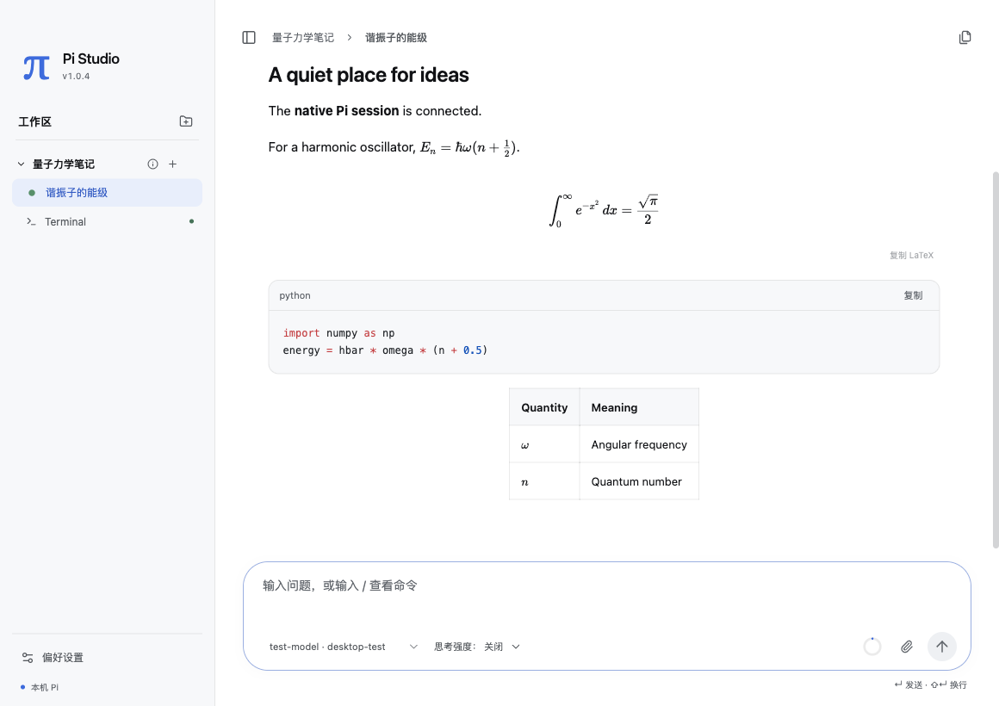
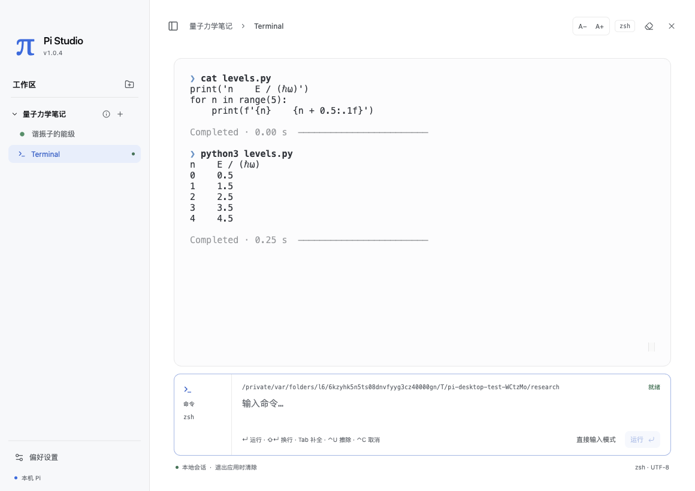

# Pi Studio

[English](README.md) · 简体中文

Pi Studio 把 [Pi](https://pi.dev/) 和本地终端放在同一个工作区里。

> 在终端里用 Pi 时，只是同时跑几个会话，就得在几个标签页之间来回切。此外，终端的公式、表格等渲染和显示也差强人意。尽管社区里也有不少桌面和网页客户端，但使用它们时，如果想自己跑条命令，还是得另开终端，很不方便。
>
> 这就是 Pi Studio 项目诞生的原因。



切到同一工作区的终端，跑一下脚本，就能核对刚才讨论的能级：



## 安装（Apple Silicon）

1. 先安装 Node.js 版 Pi。可以按 [Pi 官网](https://pi.dev/) 的说明，在终端运行：

   ```bash
   curl -fsSL https://pi.dev/install.sh | sh
   ```

   装好后，在终端运行 `pi`，选择模型并完成认证，试着发一条消息。Studio 使用你本机的 Pi，不会替你安装或升级它。如果想装插件，可以先去 Pi 官网的 **Packages** 页面找一找，再按插件说明安装。

2. 在本仓库的 **Releases → Assets** 下载 [`Pi-Studio-1.2.4-mac-arm64.dmg`](https://github.com/ymd-physics/pi-studio/releases/download/v1.2.4/Pi-Studio-1.2.4-mac-arm64.dmg)。`Source code` 是源码归档，不是安装包。

3. 安装前，在 DMG 所在的目录运行以下命令，把输出的 SHA-256 与[该版本发布页](https://github.com/ymd-physics/pi-studio/releases/tag/v1.2.4)列出的值核对。如果不同，请删除这个 DMG，重新从发布页下载，不要安装。

   ```sh
   shasum -a 256 Pi-Studio-1.2.4-mac-arm64.dmg
   ```

4. 打开 DMG，将 **Pi Studio.app** 拖入「应用程序」（Applications），弹出磁盘映像，再从「应用程序」启动。

**首次打开遇到提示？** Pi Studio 尚未使用 Apple Developer ID 签名，也未经 Apple 公证。macOS 提示「无法打开」或「已损坏」，不一定是安装包坏了。先按上面的方法核对 SHA-256；如果一致但仍打不开，把 macOS 版本和完整提示发给你的 agent 或 AI 助手，请它帮你排查即可，不必关闭系统安全保护。

从 1.0.4 起，在「偏好设置 → 关于」里点「检查更新」，就能查看新版的更新日志、下载 DMG。Studio 不会自动安装更新。

## 快速上手

首次启动默认使用英语。在 **Preferences → Appearance → Language**（偏好设置 → 外观 → 语言）中选择「简体中文」，界面就会切换，无需重启，也不会改变对话语言。

1. 点左栏「工作区」右侧的「添加工作区」文件夹图标。选一个已有的项目文件夹，也可以当场新建一个。确认 Pi 可以访问这个目录后，点「信任工作区」。
2. 点工作区名称旁的 **＋**，选「新建对话」。可以先试一句：「请阅读 README，告诉我这个项目怎么启动，先不要修改文件。」展开对话里的工具调用记录，就能看到 Pi 读了哪些文件。
3. 想自己跑命令时，点同一个 **＋**，选「新建终端」。终端会在项目目录里启动本地 shell；你输入的命令会实际执行，但不会记入 Pi 的对话历史。
4. 下次打开工作区，点左栏里的已有对话就能接着聊。如果 Studio 找不到 Pi，先在终端运行 `command -v pi`，再到「偏好设置 → 关于」核对 Studio 识别的 Pi 路径和版本。

## 有 Linux 和 Windows 版吗？

目前只提供 macOS 安装包，因为我手头只有 Mac，没法在 Linux 和 Windows 上实际测试。

Pi Studio 基于 Electron，原则上也能为 Linux 和 Windows 构建。不过，目前的打包脚本是为 macOS 写的，内置终端也依赖 zsh，这两处可能需要调整。

可以将源码交给你自己电脑上的 agent，让它帮你完成移植。

## 从源码运行（macOS）

需要 macOS、Node.js **22.19 或更新版本**（推荐 24）、npm，以及同一安装中的 Pi CLI 和可导入的 SDK。克隆仓库并进入项目根目录，然后运行：

```sh
npm ci
npm run dev
```

```sh
npm run typecheck  # 类型检查
npm test           # 单元测试
npm run build      # 生产构建
npm run package    # 在 dist/ 生成当前架构的未签名 .app，不会安装
```

应用代码位于 `src/`，跨进程共享类型位于 `packages/shared/`，运行资源和构建脚本分别位于 `resources/` 和 `scripts/`。安装包仅作为 Release 附件分发，不纳入源码历史。

## 贡献与许可

遇到问题，欢迎在 [GitHub Issues](https://github.com/ymd-physics/pi-studio/issues) 留言，也可以发邮件给我。请写明 macOS、Pi Studio 和 Pi 的版本，再简单说说怎样能复现问题。不要附上 API 密钥、完整会话或含有隐私信息的项目文件。

如果想进行二次开发，可以先运行上面的类型检查和单元测试。

Pi Studio 由我个人借助 OpenAI 的 GPT 模型辅助开发。设计上参考了 [justhil/pi-app](https://github.com/justhil/pi-app)（`703a170`）和 [DeepSeek Harness](https://github.com/deepseek-ai/deepseek-harness) 的设计。项目使用 [MIT 许可证](LICENSE)；随附第三方组件的许可声明保留在 `resources/` 中。
